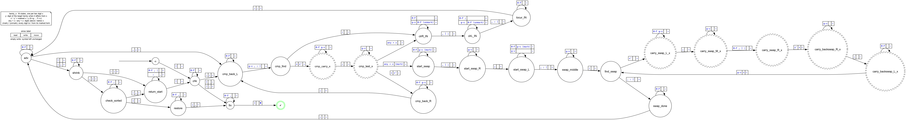

# Bubble-Sort Turing Machine

Group Members:
- Duc Anh Tran (25090085)
- Finley Ellis (24786853)
- Sibishan Ravindran (14543324) 
- Tuan Duy Nguyen (26099578)


## File Structure

```text
.
├── sort.py        # generates sort.tsv
├── machine.py     # machine definition used by sort.py
├── sort.tsv       # generated Turing Machine
├── test.py        # test cases, runs them on sim/
├── test.json      # results from test.py
├── verify.py      # reruns test.json cases on verify/
├── sim/           # local TM simulator (from Ed Resources), used before the canonical one was published
├── verify/        # canonical TM simulator (from Ed Resources)
└── assets/        # diagrams
```

- `sim/`: [Local TM Simulator](https://edstem.org/au/courses/38542/resources?download=25194)
- `verify/`: [Canonical TM Simulator](https://edstem.org/au/courses/38542/resources?download=25232)

## State Transition Diagram

The generalised state transition diagram for the sorting Turing Machine is shown below.



## Contribution Guide to Members

### 1. Generate the TSV file

Run:

```bash
python3 sort.py
```

This generates the TSV file required by the Turing Machine simulator.

### 2. Add test cases

Test cases are listed at the bottom of `test.py` as `run_case(input, comments)` calls:

```python
run_case("[]", "edge case: empty list")
run_case("[3A7F00C29B14E58D,3A7F00C29B14E58E,F000000000000000]", "nearly equal first two words")
run_case(random_input(5))  # 5 random elements; changes every run
```

The input can contain any number of elements.

Each element must:

- Be exactly 16 characters long.
- Contain only hexadecimal characters `0-9` and `A-F`.

### 3. Run the tests

Run `test.py` from the project root:

```bash
python3 test.py
```

Each test case runs on the bundled simulator in `sim/`, reading `sort.tsv`. Re-run `sort.py` first if the machine has changed.

For each case, the output shows PASS if the machine accepted the input and the final tape holds the sorted list, and FAIL otherwise.

### 4. Results

`test.json` is rebuilt on every run from the `run_case` calls, numbered in the order they appear in `test.py`. For example,

```json
"2": {
    "input": "[3A7F00C29B14E58D,3A7F00C29B14E58E,F000000000000000]",
    "accepted": true,
    "step count": 885,
    "write complexity": 70,
    "space complexity": 52,
    "head position": 0,
    "comments": "nearly equal first two words"
},
```

- **step count**: the number of transitions the machine took before halting.
- **write complexity**: the number of steps that changed a cell's symbol.
- **space complexity**: the number of tape cells used (the input length, or more if the head moves past the end of the input).

The simulator does not report write and space complexity, so `test.py` counts them while stepping through the machine. They match the values shown by the [Ed Turing Machine Simulator](https://edstem.org/au/courses/38542/lessons/118243/slides/836183), which can still be used to step through a run visually.

For any input that follows the valid grammar, every test is expected to end with `accepted` as `true` and `head position` at `0`.

### 5. Verify

Run `verify.py` to recheck `sort.tsv` and every case in `test.json` on the canonical simulator in `verify/`:

```bash
python3 verify.py
```